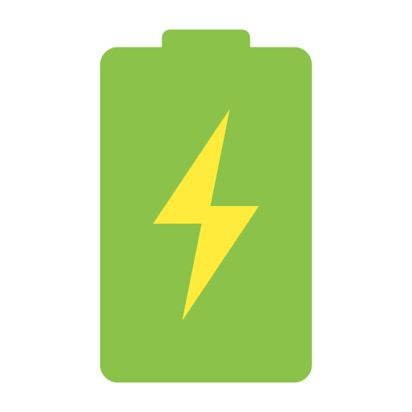

# EnergiaR

    

Aplicación enfocada en tener un registro/historial personal de energía eléctrica de tipo recargable.

## Versión 1.00 (In development)

Este proyecto está bajo **_Licencia MIT_**, por lo tanto cualquiera es libre de acceder al código, usarlo y cambiarlo según los lineamientos de la licencia MIT.

El principal propósito de este proyecto es el aprendizaje básico con:

* C#
* .NET 10
* EntityFramework Core

### Proyectos

| Proyecto | Tipo | Lenguaje | SDK | Rumtime |
| :------: | :--: | :------: | :-: | :-----: |
| EnergiaR.DTO | ClassLib | C# 14 | .NET 10.0.402 | .NET 10.0.13 |
| EnergiaR.Fls | ClassLib | C# 14 | .NET 10.0.402 | .NET 10.0.13 |
| EnergiaR.ORM | ClassLib | C# 14 | .NET 10.0.402 | .NET 10.0.13 |

### Licencias y librerías de terceros

| Nuget | Versión | Licencia | Proyecto |
| :---: | :-----: | :------: | :------: |
| Microsoft.EntityFrameworkCore | 10.0.13 | MIT License | EnergiaR.ORM |
| Microsoft.EntityFrameworkCore.Tools | 10.0.13 | MIT License | EnergiaR.ORM |
| Microsoft.EntityFrameworkCore.Sqlite | 10.0.13 | MIT License | EnergiaR.ORM |
---
Cada librería mantiene su respectivo aviso de copyright y licencia.